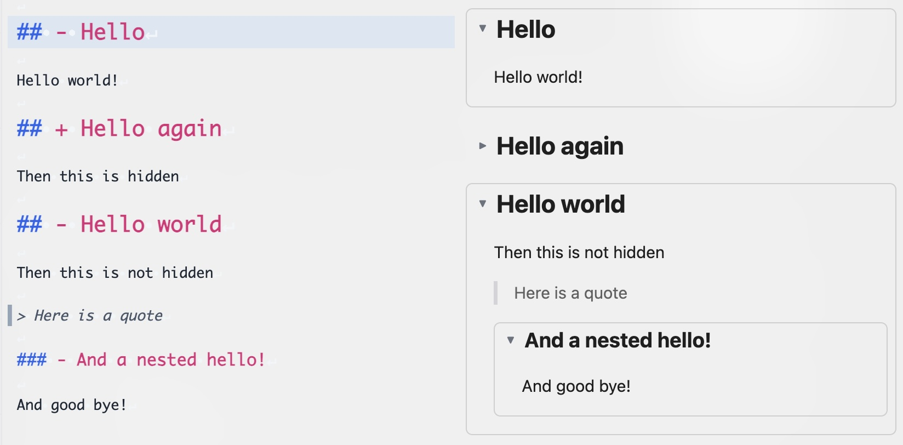

## Toggle Section

Section folding in Preview panel. This transforms a +/- leading header markdown section into a `<details>` HTML element in Preview panel. Especially useful to keep details folded in a tidy manner.



- Insert a prefix `-` in any section to keep it unfolded

  ```markdown
  ## - Unfolded

  Content

  - Item One
  - Item Two
  ```

- Or isert a prefix`+` for a folded section

  ```markdown
  ## + Folded

  Content

  - Item One
  - Item Two
  ```

- It spports multi-layer sections

  ```markdown
  ## - Title

  Summary

  ### - Sub Title A

  Paragraph A

  ### - Sub Title B

  Paragraph B

  ### + Appendix (folded)

  Appendix Content
  ```
